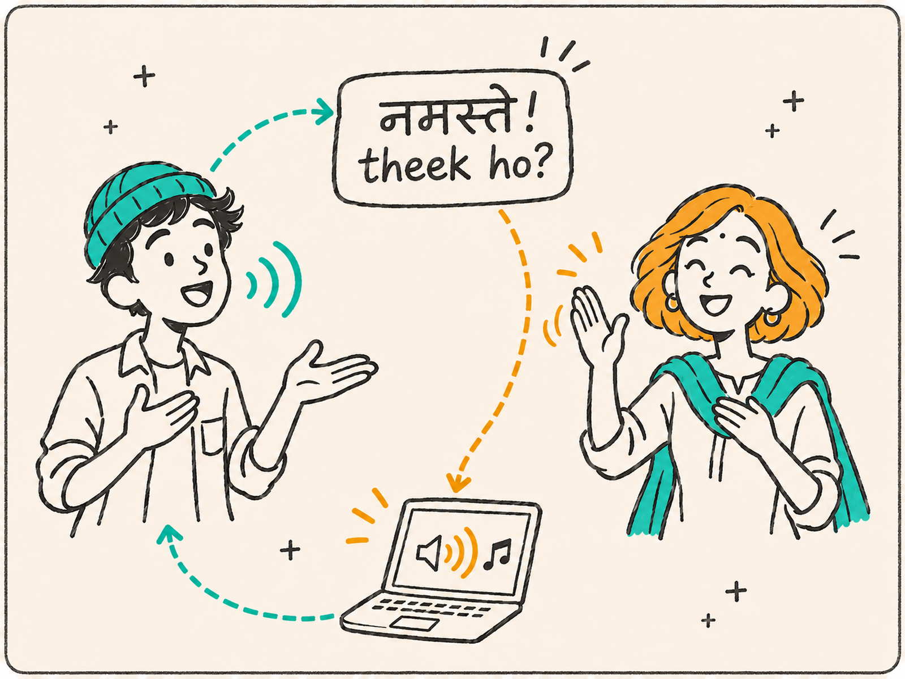
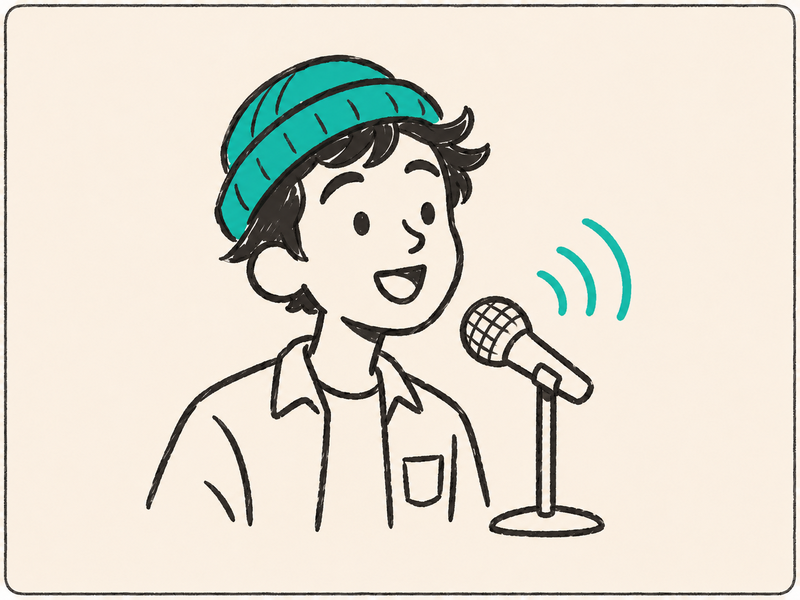
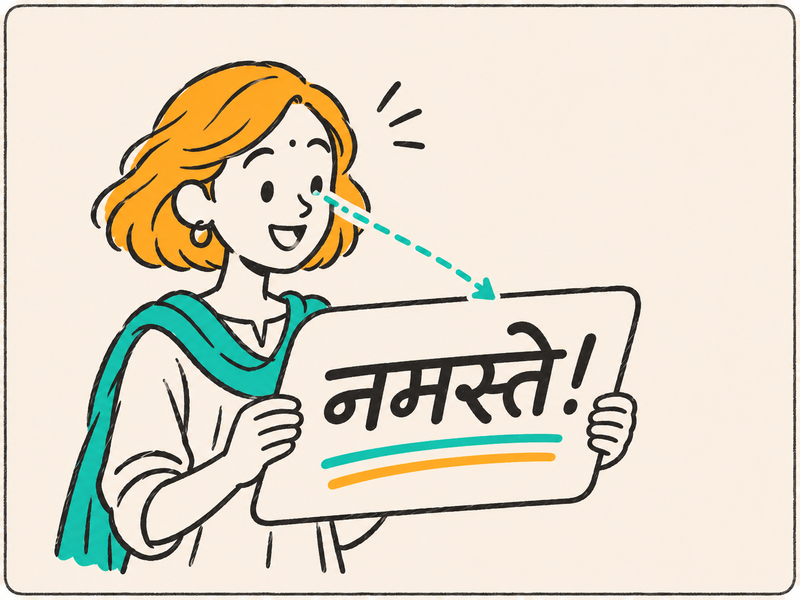
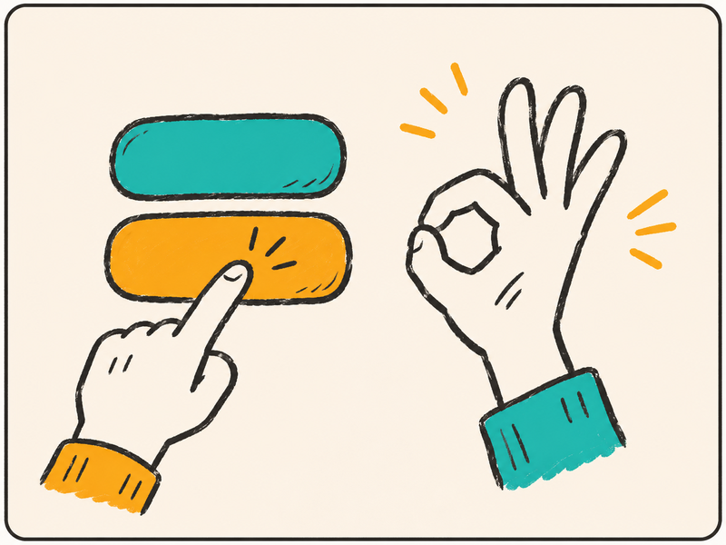
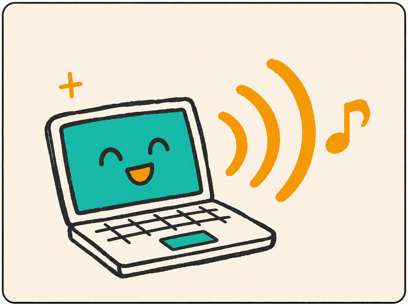
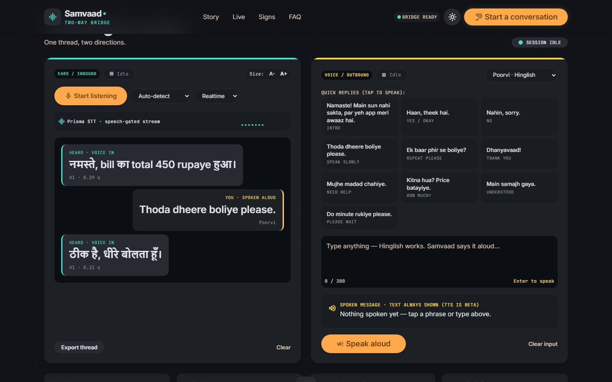
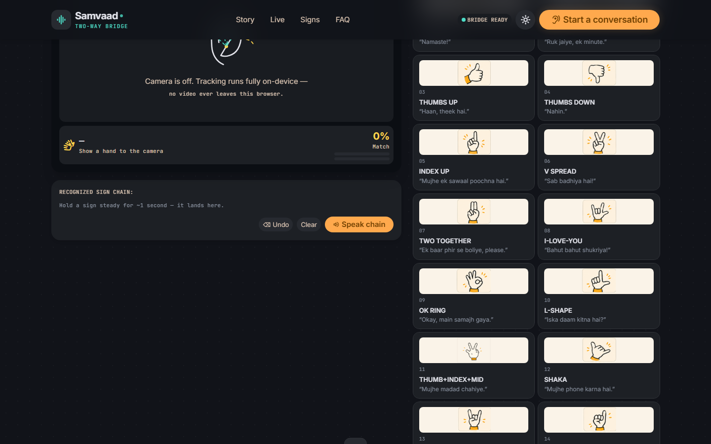

<div align="center">



# Samvaad — संवाद

### *Two people. No interpreter in the room. Finally understanding each other.*

**🌐 Live demo: [samvaad-bridge.netlify.app](https://samvaad-bridge.netlify.app)**

[](https://samvaad-bridge.netlify.app)
[](https://docs.gnani.ai)
[](https://github.com/Hazz-Y/samvaad)

A two-way communication bridge between **deaf and hearing people** — built for the
Gnani AI **Great Indian AI Internship Challenge**. Software only: one laptop,
one browser tab, zero hardware.

</div>

---

## The problem


Ananya is buying medication for her grandmother. The pharmacist is rushed, the
shop is loud, and Ananya is deaf. He rattles off the dosage while turning to
the shelf — the lipreading chain shatters. For medicine, a guess is not good
enough. Notes apps are slow, awkward, and everyone in the queue is watching.

**Samvaad turns that laptop into a bridge:** his words become large live
captions; her taps, typed text and hand signs become a natural spoken voice.
Both directions land in one conversation thread.

## How a conversation flows

| | | | |
|:---:|:---:|:---:|:---:|
|  |  |  |  |
| **They speak naturally** — only speech leaves the laptop, silence is gated out | **You read big captions** — Hinglish rendered the way you read it | **You tap, type, or sign** — quick phrases, free text, or 16 hand signs | **Samvaad speaks it aloud** — warm neural voice, text always shown too |

## The bridge in action



- **One thread, two directions** — everything heard (teal, left) and everything
  spoken back (amber, right), exportable as a `.txt` record of the conversation.
- **Live stats, not marketing numbers** — STT `processing_time`, detected
  language, TTS latency and request count straight from the API responses.
- **Sign studio** — MediaPipe hand tracking (21 keypoints, fully in-browser)
  feeds a custom geometric classifier: **16 signs**, temporal smoothing, live
  confidence meter, skeleton overlay. Honestly labeled *limited vocabulary* —
  this is not full ISL, and the UI says so.



## Gnani models & APIs used

| Capability | Endpoint | Options |
|---|---|---|
| Realtime STT | `wss://api.vachana.ai/stt/v3/stream` | `prisma-v3.0`, `indic-auto`, `codemix`, 16 kHz PCM frames |
| STT fallback | `POST https://api.vachana.ai/stt/v3` | same options; silence-gated chunks cut at pauses |
| TTS | `POST https://api.vachana.ai/api/v1/tts/inference` | `timbre-v2.5` / `v3.0` — default voice **Poorvi** (Hinglish) |

`format=codemix` is the magic for India: *"ऑफिस में meeting है क्या?"* comes out
with Devanagari for Hindi and Latin script for English words — the way people
actually read.

## Architecture

```
Chrome ── mic (16 kHz PCM via AudioWorklet, RMS speech gate + pre-buffer)
  │  ws://…/ws/stt ───────────► FastAPI proxy ──► wss://api.vachana.ai/stt/v3/stream
  │  POST /api/stt (fallback) ─► FastAPI/Netlify Fn ──► POST …/stt/v3
  │  POST /api/tts ────────────► FastAPI/Netlify Fn ──► POST …/api/v1/tts/inference
  └─ MediaPipe hand tracking + sign classifier: 100% in-browser, nothing uploaded
```

- **The API key never reaches the browser** — it lives in `.env` locally and in
  a Netlify environment variable in production.
- Realtime STT is proxied because browsers cannot send the `x-api-key-id`
  WebSocket header. On Netlify (no WebSockets), the app **auto-falls back to
  chunked REST mode without stopping the mic** — same captions, cut at pauses.
- All Gnani calls are serialized (some accounts allow 1 active request) and
  429/5xx retried with exponential backoff, per the official error reference.

## Run locally (full realtime mode)

Requirements: Python 3.10+, Chrome.

```bash
pip install -r backend/requirements.txt
copy .env.example .env          # paste your Gnani API key
cd backend
uvicorn main:app --port 8017    # or: py -3.10 -m uvicorn main:app --port 8017
```

Open **http://localhost:8017** and allow the microphone.

### Test scripts (verified against the live API)

```bash
py -3.10 tests/test_stt.py --selftest   # Timbre speaks Hinglish -> Prisma transcribes it back
py -3.10 tests/test_stt.py              # your own wavs from tests/samples/ (<=30 s each)
py -3.10 tests/test_realtime.py         # realtime WebSocket path (server must be running)
```

## Deploy your own (Netlify)

```bash
netlify sites:create --name <your-site>
netlify env:set GNANI_API_KEY <your-key>
netlify deploy --prod
```

`netlify.toml` publishes `frontend/` and maps `/api/*` to the serverless
functions in `netlify/functions/`.

## Saving credits (5,000 programme credits)

- Client-side **speech gate**: silence is never sent to the API. In realtime
  mode the stream pauses between utterances and a `commit` finalizes the
  segment; in REST mode only voiced chunks upload.
- **TTS cache**: repeating a quick phrase costs zero credits after first use.
- Text capped at 500 chars; sub-0.3 s audio blips discarded client-side.

## Honest limitations

- The sign studio is **16 signs, not sign language.** Indian Sign Language is a
  complete language with grammar — out of scope here, and the UI labels the
  feature "limited vocabulary · beta".
- Timbre is beta, hence every reply is shown as text *before* the voice call.
- Samvaad is for everyday counters and conversations — **not a replacement for
  a certified interpreter** in medical or legal settings.

---

<div align="center">

Built with **Gnani Prisma** (STT) + **Gnani Timbre** (TTS) · api.vachana.ai

*Two ways. One conversation.*

</div>
